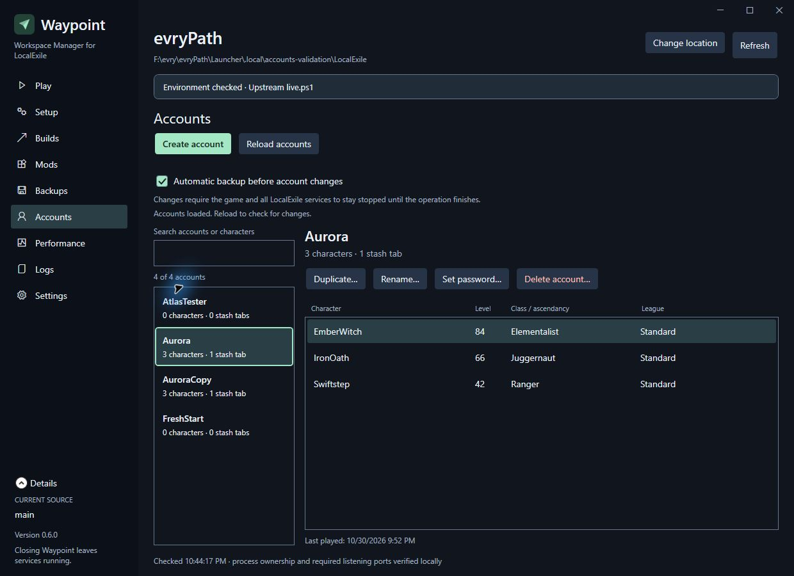
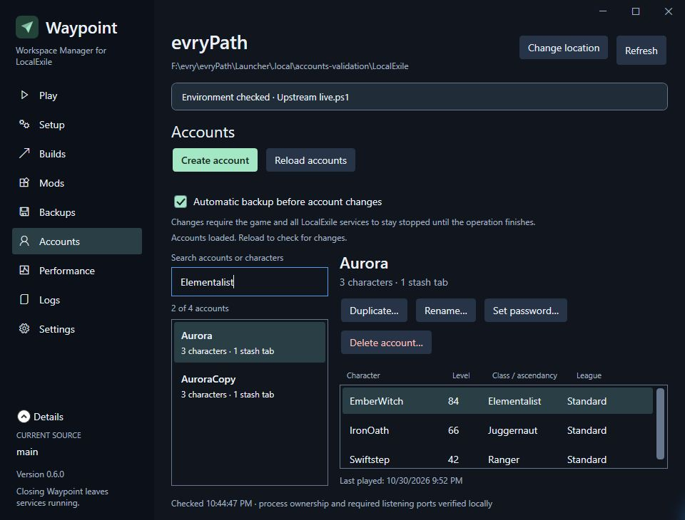
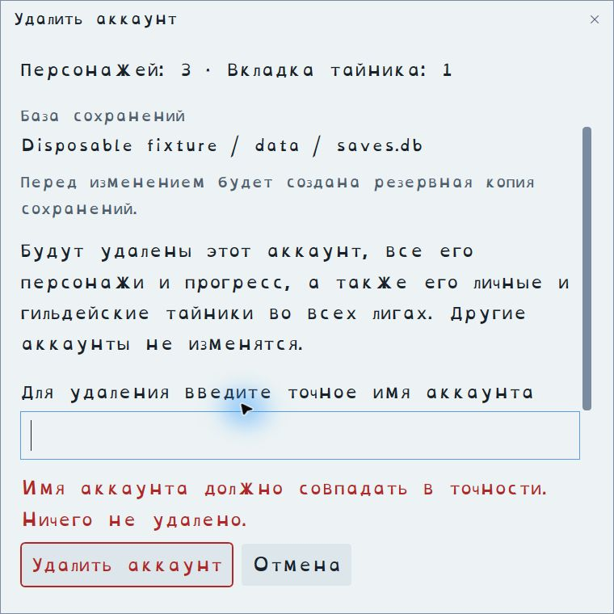

# Accounts UI and validation — 0.6.0 local review

The 0.6.0 UI and review package remain local and unreleased. The Accounts workflow adds a new capability, so the review version is 0.6.0.
The published 0.5.2 package is unchanged. See the [user guide](../account-management.md).

## Design resources and implementation

Reuse the project-scoped MIT UI UX Pro Max skill pinned at `9a3f14f7423037ccb8feeb4fee7482291b9c820e`,
recorded in [the existing source/hash lock](design-skill.lock.json). Its local search scripts and instructions were
read before use. WPF searches for keyboard commands, focus and observable list presentation informed the page;
Microsoft WPF guidance and the existing shared dialog frame supply native behavior. The generated generic
Hero/Features/CTA design recommendation did not fit a desktop account tool and was rejected. No new packages,
framework changes, services, system settings or skill installations were needed.

The page keeps search/list beside characters and puts actions before long content. It uses existing semantic theme
resources, English/Russian localization, reading fonts, text sizes, visible keyboard focus and native controls.
Loading, empty/filter-empty, failed-query, unsupported-schema and runtime read-only states are explicit. Selection
survives refreshed data by identity. Queries do not reread all character progress on each five-second status poll.

Forms share Waypoint's themed DialogWindow; scrolling content and fixed actions remain separate. They show the
reviewed database and backup policy. Duplication defaults to full copy and offers an empty account. Deletion requires
the exact name, with Cancel as the default Enter action. Passwords are cleared on dialog close and omitted from
retries/transcripts. A checkout/profile change invalidates the reviewed database context.

## Checks performed

- Full solution build: zero warnings/errors.
- **1,056 passing automated assertions/tests**: 840 desktop, 93 Core, 18 runtime bridge, 13 mod startup, 18 mod control,
  9 mod transport, 25 source/save, 21 account bridge and 19 Python account-data tests. The Python suite discovered
  20 tests; one symlink case was skipped because this Windows environment did not permit creating a symlink.
- Disposable SQLite fixtures: read-only browsing, credential exclusion, class/ascendancy/fallback display,
  full/empty copies, new identities, opaque progress preservation, vitals ownership clearing, rename/stash movement,
  password verifiers, typed deletion/archive, unrelated-account preservation, collisions, stale revisions, unknown
  schemas, incomplete imports, invalid identities, SQL injection, WAL reads, locked writes and transaction rollback.
- Bridge fixtures: game/login/Gateway/Patch/watchers, account service and port 7000, foreign/not-yet-listening runtimes,
  ownership conflicts, backup failure, a runtime appearing during backup, and the selected-database binding. No test
  relaxes the production writer gates. A pre-existing client-key preparation check now uses test-only inventory so
  another installation's live runtime cannot mask its intended missing-key assertion.
- A separate locally cloned LocalExile at `89b7aa908213ac8eb9b5ac5aa7ae54c14189c3e9` supplied actual Storage/Core
  classes for fixture registration and validation. Its AccountService accepted both plain-password and official-client
  digest login for copied accounts and a changed Unicode password, and confirmed original login, new identities and
  character levels. No emulator source or real saves were edited.
- A private fixture wrapper exercised RuntimeClient → actual PowerShell operations → Python → disposable SQLite,
  including automatic backup and UTF-8 credentials. Only its process inventory was simulated. No password appeared
  in the captured output/result.
- A production Delete request against the disposable database was refused while another installation's game/services
  were running. The database hash was unchanged. Live processes were neither adopted nor stopped. Production account
  browsing still loaded characters with edits disabled.
- Native fixture UI: full-copy default, empty-copy option hiding character-name fields, Escape cancellation,
  ascendancy search, Enter cancelling deletion, and blank typed-name deletion showing an inline error with no submit.
- Native Russian Light/OpenDyslexic at 150%, 700×650 fixture window: page content scrolls, account/character selection
  remains usable, clipped cell text retains full tooltips, and dialog actions remain fixed while content scrolls.
  The first pass exposed a one-letter-wide heading beside translated action buttons; moving tools below the title
  corrected it. An automated minimum-workspace-width regression check covers the failure.
- In-process frame checks cover all five new action forms in default English, Russian light/150% OpenDyslexic and
  High Contrast resources, including action-footer visibility, window styles, accessible Close and safe cancellation.

Commands: `dotnet build Launcher.slnx`, both executable check projects, all six documented PowerShell suites
(including Accounts), and `python tests/AccountData.Tests.py`. Private harnesses and raw logs are under ignored
`.local/accounts-validation` and `.local/commit-validation-logs`; they are not distributed. Owner settings were
unchanged during fixture testing.

## Evidence and limits

The private UI driver instantiates the production page/forms without RuntimeClient or write callbacks. It exposes
its modal dialogs in the taskbar so the native automation tool can target keyboard input; production dialogs retain
owned, single-taskbar-window behavior. It is a presentation fixture, not evidence of a GUI-to-server mutation.
Captured fixture images are under `.local/accounts-validation/ui`.

No real character was deleted, copied or edited, no game-world entry with a copied character was tested, and no
screen-reader listening, physical display/DPI transition or live Windows High Contrast toggle was performed.
Automated layout/resource checks are not claims of those physical tests. Arbitrary mod progress references are
preserved rather than understood or rewritten. Keep manual external service starts paused during offline edits.

The clean-source portable package at commit `895fbb46890230c50661bf35e214e91ea4bf8621` was verified and extracted
outside the development folder. All **415** payload hashes/sizes passed, alongside archive checksum, path containment,
Windows x64 header, version/source identity, Russian satellite, account helpers and font/runtime licenses.
ZIP SHA-256: `e9374efffc3dd70ecc21aaaabf0de62d57963a12bb8fb48cbaeac9564dcb1f53`.

The extracted production EXE loaded all four disposable accounts. Ctrl+6 selected Accounts, Ctrl+F focused search,
and an Elementalist query found both matching accounts. At 960×730 the action row wrapped and character details
remained usable. The full-size capture is 1240×900. Fixture browsing left the database hash unchanged, and owner
preferences still matched the original byte-for-byte. No game/server processes were started or stopped.

## Remote baseline observed during final review

Read-only `git ls-remote origin refs/heads/main` returned `f3e6a94b0a419d7a7eddaa09405a183b853115c4`.
The local remote-tracking reflog records an update by push at 2026-10-30 22:28:06 -0700, through the backend commit.
This was discovered and reported after resuming from the requested computer-use pause. No push, tag or release was
run after resuming. The database-binding fix, Accounts UI and review-package preparation remain beyond that remote
baseline; remote history was left untouched. Publication still requires owner review and authorization.
