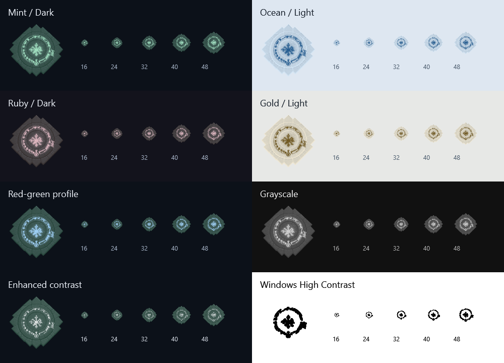
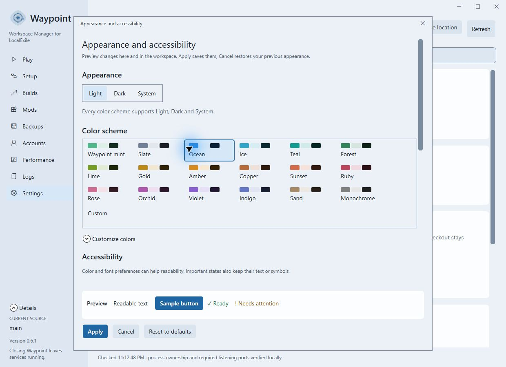

# Waypoint emblem — 0.6.1 local review

This is an unpublished review build containing the 0.6.0 account manager plus the emblem update. No push, tag or
release is authorized. The existing app remains WPF/.NET 10; no application packages or system settings were added.

## Visual reference and selected artwork

The [actual PoE1 screenshot](https://images.mmorpg.com/images/contentImages/122021/waypoints.jpg) in this
[PoE1 guide](https://www.mmorpg.com/guides/beginners-guide-to-path-of-exile-2000121370) was inspected directly and
supplied to the built-in image_gen tool as a reference. It shows the distinguishing combination used here: angular
masonry around a recessed circle, an inner perimeter band of small glowing glyphs and a curling central sigil.
An additional [PoE1 Reliquary forum reference](https://www.pathofexile.com/forum/view-thread/2465324) was researched;
that decoration was not used as the source for the final generation.

Earlier generic rune/compass-like proposals were rejected. The reference-based raster and a subsequent lighting edit
became [the selected master](../../branding/waypoint-master.png). Only the etched glyphs/channels emit light, with a
soft spill onto nearby stone. A blue outline around the outer bricks was rejected and is absent from the selected
artwork. No screenshot or extracted game asset is included in application output. This is original generated artwork,
not an assertion of a pixel-exact recreation of the game's asset.

[Artwork provenance](../../branding/waypoint-artwork.json) records the actual built-in generation and final edit
prompts, reference URLs and preparation decisions. The master is preserved in the repo, with a 192-pixel WPF source
and ten transparent PNG-backed ICO frames (16, 20, 24, 32, 40, 48, 64, 96, 128 and 256 pixels). Run
`scripts/New-Icon.ps1` to reproduce the derived assets; repeated runs were verified byte-identical. The .NET app
bundles only the compact source and ICO as resources, not the full-size master or development skill.

## Theme and accessibility behavior

The sidebar uses the same raster geometry as the Windows icon, recolored through the existing semantic resources:
Accent controls the engraved light, Logo background controls the stone, and secondary text supplies neutral surface
detail. Contrast protection adjusts the engraving ink against its stone/sidebar surfaces. The painted glow is static;
there are no timers, shader effects or pulsing animations. The 44-DIP emblem leaves space beside the unchanged name.

All 18 presets support Dark, Light and both System resolutions, including Red–green, Blue–yellow and Grayscale
profiles. Custom light/dark color choices are independent. Enhanced contrast suppresses the softer light channel.
Windows High Contrast removes the masonry/glow and uses the actual engraving cores in system WindowText color,
slightly thickened at source resolution to remain visible at small sizes. It takes priority over custom palettes.
The decorative bitmap is a Border background rather than an interactive or separately announced Image; it has no
keyboard stop or automation peer. The visible adjacent product name remains available to assistive technology.
This follows the app's native WPF presentation and [WPF automation-peer model](https://learn.microsoft.com/en-us/dotnet/desktop/wpf/controls/ui-automation-of-a-wpf-custom-control).

The Windows EXE, taskbar and window icon intentionally retain a fixed blue light treatment with the same geometry.
Windows needs a stable shell identity outside the app's color preferences; changing the palette does not rewrite
executable resources or force a Windows icon-cache refresh. An existing shortcut to an older build still targets
that older executable until the owner updates it.

The enlarged sample is for inspecting geometry; 16–48 samples are drawn at their native sizes. Small sizes retain
the angular footprint, luminous ring and center; individual miniature rune marks naturally merge at 16 pixels.

## Validation

- Full solution build: zero warnings/errors. **1,349 passing assertions/tests**: 1,133 desktop, 93 Core, 18 bridge,
  13 mod startup, 18 mod control, 9 mod transport, 25 source/save, 21 account bridge and 19 Python account tests.
  The Python suite discovered 20 tests; the existing Windows symlink test remains explicitly skipped.
- Brand integration checks exercise all 18 schemes × Dark/Light/System-dark/System-light × four vision profiles
  using the real resource dictionary and sidebar brush. They verify frozen themeable bitmaps, transparent corners,
  nonempty geometry, complete grayscale recoloring, independent custom accent/surface changes, reading/reduced-motion
  stability, decorative automation behavior, High Contrast precedence and all ten embedded ICO sizes.
- Existing checks continue to cover all pages, English/Russian, 150% reading text and High Contrast resources.
- Actual renderer contact sheet inspected at native 16–48 pixels and enlarged across eight representative settings.
  An early High Contrast threshold made the center a solid blob; using the brighter engraving cores and narrowly
  thickening them corrected it without introducing an outer masonry outline.
- Native running-app inspection at 1240×900. Ctrl+9 reached Settings. Light and Ocean were previewed through the
  existing appearance dialog; the sidebar recolored immediately. Cancel restored the original mint/dark scheme.
  Owner preferences stayed byte-for-byte unchanged. The preview used the disposable LocalExile checkout and no
  game/server operation was started or stopped.

The resource/layout checks do not establish physical monitor/DPI transitions, a live Windows High Contrast toggle
or screen-reader listening. Those physical checks were not performed. The final clean portable package and native
minimum-window confirmation are recorded with the local review artifacts after packaging.
