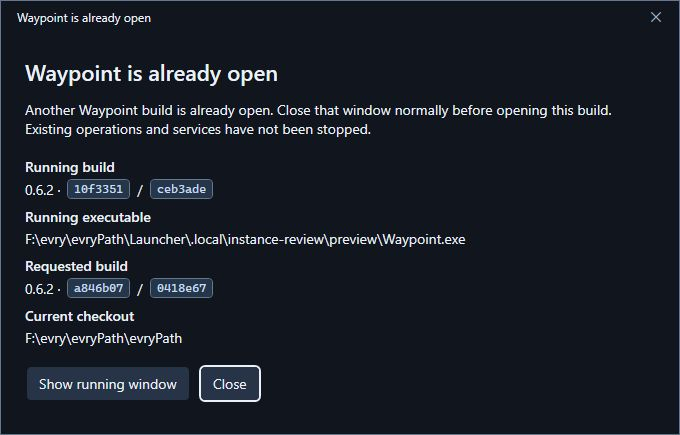
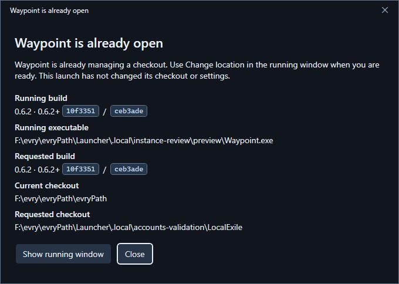
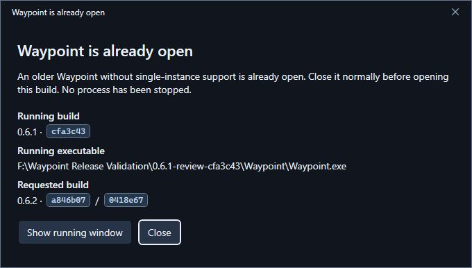
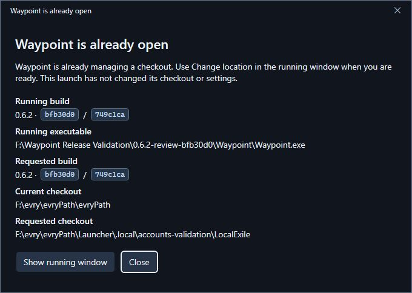

# Single-instance startup

Included in Waypoint 0.6.4. The validation records below describe the original 0.6.2 review builds.

## Normal use

Double-click Waypoint normally. Reopening the same build brings back the original workspace, restoring it from
minimization and preserving a maximized state. An existing modal is retained. The second process exits quietly
after handoff; it does not construct a workspace, start status polling or write settings. Windows foreground rules
still apply: if Windows denies focus, the existing taskbar button flashes rather than forcing input focus.

Opening a different version/build shows **Waypoint is already open**, with running/requested build identity and
the running executable. This also distinguishes two different compiled builds of the same product version. Choose
**Show running window**, let any operation finish and close it normally; then reopen the desired build.
No process, game or service is automatically stopped. **Close**/Enter dismisses only the notice.

If another launch supplies `--repo` with a different checkout, the notice shows both paths. Change checkout through
the running window's **Change location** control when ready. The launch request never changes source selection,
preferences, accounts, services or an active operation. Equivalent casing/trailing separators are treated as the
same path. Relative CLI paths are resolved by the launching process before handoff.

A conflict notice has a temporary process of its own until dismissed. That is distinct from two workspace windows.
The running app remains the owner even when it is busy, starting or cannot be contacted. A timed-out/inaccessible
owner never grants permission for a duplicate workspace. Use the same Windows permission level for both copies.
On exit or crash the kernel releases ownership; no persistent lock file needs manual cleanup.

## Older builds and developer use

Older releases do not contain this protocol. On startup, the new app checks known/current executable names in the
same user/session, then verifies executable metadata, brand information, the Core assembly reference and protocol
marker without loading their assemblies. A supported legacy copy that is already running is identified explicitly.
Name alone is insufficient. This is a best-effort compatibility check, not a way to control arbitrary older binaries:
an old build launched after a new one, an unrecognized renamed legacy executable, or an inaccessible process may
not be caught. Nothing is terminated to enforce the policy. The separate runtime writer lock remains in effect.

For deliberate development only, open PowerShell in the folder containing the test EXE and run:

```powershell
.\Waypoint.exe --allow-multiple
```

The extra workspace has **Multiple-instance test mode** in its title/sidebar. This bypasses only desktop ownership,
not the runtime writer lock, ownership checks or account safeguards. Preferences/backups are still shared; this
option does not create an isolated installation or merge competing settings. It is intentionally absent from ordinary
user settings. Close extra test windows normally when finished.

## Implementation and verification

Core owns a stable, per-user/session named mutex and local named-pipe protocol. A dedicated thread owns/releases
the mutex to avoid async thread-affinity bugs. The pipe requires the same Windows user/elevation, verifies peer PIDs,
limits packet size and expires stalled clients. The desktop grants foreground permission where Windows allows it,
restores the original window and targets its last active popup. No Topmost or forced-input workaround is used.
Identity contains the displayed product version, assembly informational version and Desktop/Core byte fingerprint;
install folder and executable filename do not determine ownership. See [runtime contract](docs/runtime-contract.md).

The implementation follows Microsoft's [CurrentUserOnly pipe option](https://learn.microsoft.com/en-us/dotnet/api/system.io.pipes.pipeoptions),
[foreground-window rules](https://learn.microsoft.com/en-us/windows/win32/api/winuser/nf-winuser-setforegroundwindow)
and [foreground delegation](https://learn.microsoft.com/en-us/windows/win32/api/winuser/nf-winuser-allowsetforegroundwindow).
It uses the existing WPF dialog frame, localization, palette and accessibility resources; no new framework or packages.

- Solution build: zero warnings/errors. **1,402 passing assertions/tests**: 1,160 desktop, 119 Core, 18 bridge,
  13 mod startup, 18 mod control, 9 mod transport, 25 source/save, 21 account bridge and 19 Python account tests.
  The existing Windows symlink case is explicitly skipped (20 Python tests discovered).
- Process/pipe tests: eight simultaneous claims elect exactly one owner; real separate-process discovery; same
  namespace across install paths/names; waiting for listener/window startup; build/checkout/busy/closing outcomes;
  malformed oversized input; a client that stalls; unreachable-owner refusal; normal disposal and forced crash of
  only a disposable fixture host; successful endpoint reuse afterward. No real launcher/game/server was force-killed.
- Native app: same-path, identical-folder-copy and renamed-EXE repeated launches exit with code zero, retaining
  the original process. Minimized and maximized-then-minimized restoration verified. Relaunch while Appearance was
  open retained the same dialog and one workspace. Checkout conflict displayed both paths; different-build conflict
  displayed distinct source/binary hashes. The explicit override displayed its warning and closed normally.
- Native legacy validation: an actual 0.6.1 review build was running before a 0.6.2 launch. The new app showed the
  older-build notice without constructing a second workspace. Both validation windows were then closed normally.
- In-process notices: themed caption, resize/scroll/action layout, accessible Close and safe dismissal checked in
  English, Russian/150% OpenDyslexic and High Contrast resources. Owner settings remained byte-identical throughout.







## Clean portable package confirmation

The self-contained Windows x64 review ZIP was built from clean source
`bfb30d0e6d9bbd1073fd2c9fbd5bcd0ef6462e27`, then verified and extracted to a new folder outside the development
checkout. All **415 payload hashes/sizes**, archive checksum, branding/source identity, x64 header, resources and
license checks passed. ZIP SHA-256: `e74468303d4b1c6f21896fb6d3b1068a3259e817472bee963eaacd16df73debf`.

The extracted EXE opened the owner's normal saved checkout. An identical copy extracted into another folder
handed off and exited with code zero; the original process remained the only workspace. A different-checkout
request in that same clean package produced the expected notice, then Enter dismissed it. Settings still matched
the original bytes. Only the final review workspace was left open; no special startup command is needed.



The earlier screenshots are preview evidence; source hashes identify their particular builds.
Different Windows accounts/sessions, mixed-elevation launches, physical DPI changes, screen-reader listening and
live Windows High Contrast toggles were not exercised. The related scoping/failure paths are implementation limits,
not claims of those physical tests. No game/server lifecycle or account mutation was needed for this startup change.
